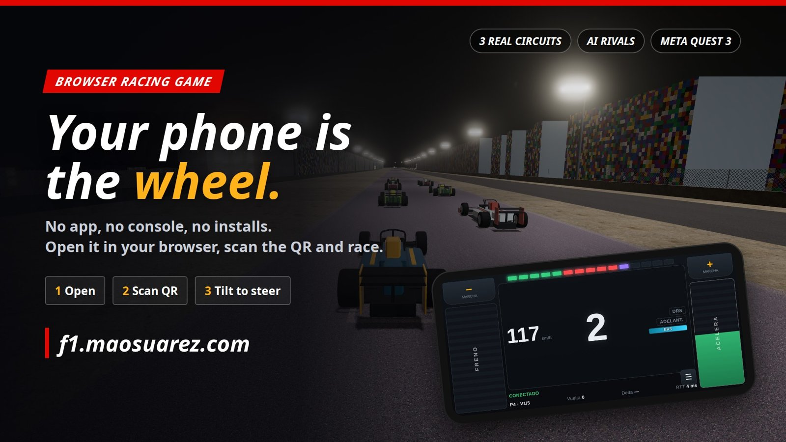
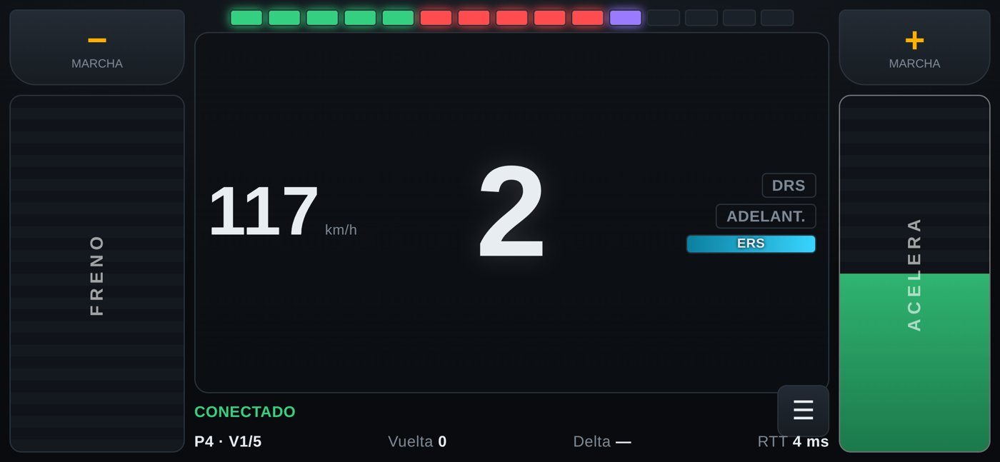
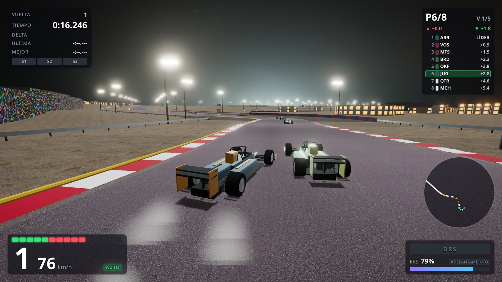
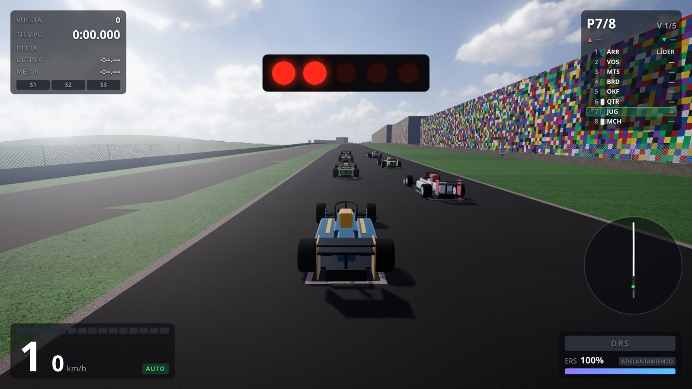
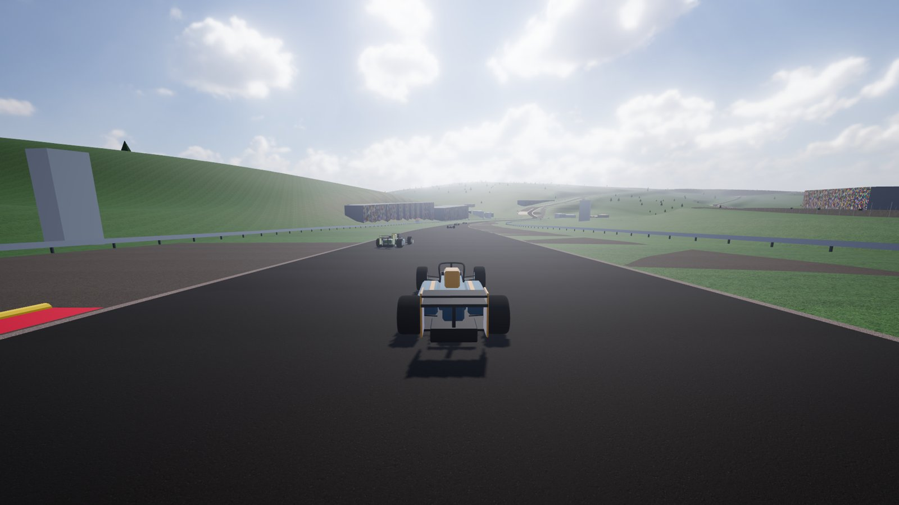
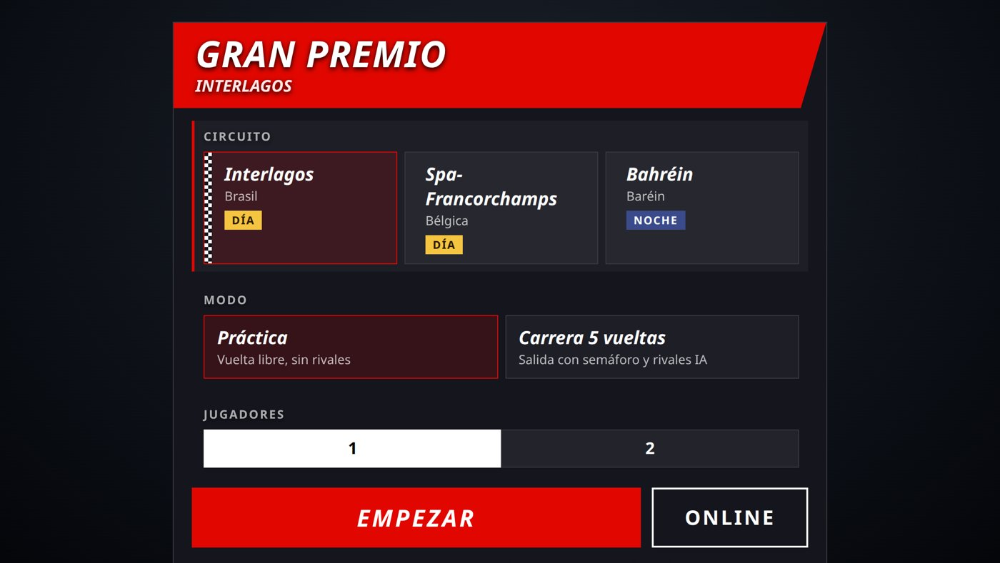

<div align="center">

# 🏁 Pocket Paddock

### Your phone is the steering wheel. Your browser is the race track.

**A browser racing game where your smartphone becomes the wheel, with no app, no installs and no console.**
Scan a QR code, hold your phone like a wheel and race real-world circuits in 3D. It also runs in VR on Meta Quest 3.

<br>

## 🏎️ [**PLAY NOW → f1.maosuarez.com**](https://f1.maosuarez.com)

<br>


<br>



</div>

---

## 🚦 Lights out in 3 steps

| | |
|---|---|
| **1. Open** | Go to [**f1.maosuarez.com**](https://f1.maosuarez.com) on your PC, laptop or Meta Quest 3 browser. |
| **2. Scan** | Scan the QR code on screen with your phone. That pairs your phone with your session. |
| **3. Race** | Hold the phone sideways like a wheel. **Tilt to steer**, tap to accelerate, brake and shift. |

No accounts and no downloads. You can be racing in under 30 seconds.

<div align="center">

<br><sub><i>The phone wheel: brake and throttle pedals, shift paddles, DRS/ERS buttons, a live speedometer and RPM LEDs.</i></sub>
</div>

---

## 🏆 Race features

### 📱 The phone is the wheel
- **Tilt steering** using the phone's motion sensors, with speed-sensitive response.
- **Touch pedals and paddles** for throttle, brake and sequential up/down shifts.
- **The phone works as a dashboard too**, showing speed, gear, RPM shift lights, DRS and ERS state, lap and delta.
- **Haptic feedback** on kerbs, gear changes and the rev limiter.
- **Shake to activate DRS or ERS**, so you never have to take your hands off the wheel.
- Low-latency WebSocket link: input at **60 Hz**, telemetry back at **20 Hz**.

### 🏎️ It feels like a real race car
- An **8-speed sequential gearbox** with a rev limiter and RPM LEDs, plus an automatic mode.
- **DRS** that opens only in the real DRS zones.
- **ERS and overtake mode**: an energy store you spend tactically to attack or defend.
- **Track limits, kerbs, grass and gravel**, each one affecting grip.
- Real **elevation changes** taken from terrain data.
- A **procedural hybrid engine sound** generated live with Web Audio.
- Cameras: **cockpit/helmet, chase and TV**, with dynamic FOV for a sense of speed.

### 🌍 Three real-world circuits
Built from public racing-line data, OpenStreetMap and elevation models:

| Circuit | Highlights |
|---|---|
| 🇧🇷 **Interlagos**, São Paulo | Senna S, Curva do Sol, Bico de Pato, the climb to the pits |
| 🇧🇪 **Spa-Francorchamps** | La Source, Eau Rouge–Raidillon, Pouhon, Bus Stop chicane |
| 🇧🇭 **Bahrain**, *night race* | Floodlights, desert run-off, heavy braking into Turn 1 |

<div align="center">

<br><br>
&nbsp;

</div>

### 🏁 Game modes
- **Practice**: hot laps with sector times, delta and best lap.
- **5-lap Grand Prix** against **AI rivals** from fictional teams.
- **2-player split screen** on the same PC, with a phone each.
- **Online racing** between PCs.
- **🥽 VR mode on Meta Quest 3**: sit in the cockpit with in-car instruments and steer with your phone, or use the Quest controllers.
- Keyboard and USB gamepad are supported as fallbacks.

<div align="center">

</div>

---

## 🛠️ Under the hood

```
 📱 Phone (/wheel/)           🖥️ Relay (FastAPI)            🏎️ PC / Quest (Three.js)
 ─────────────────           ──────────────────            ─────────────────────────
 motion sensors   ──60 Hz──▶  WebSocket rooms   ──────▶    fixed-step physics (120 Hz)
 touch pedals                 /ws/{room}                   interpolated rendering
 dashboard UI     ◀──20 Hz──  (no game logic)  ◀──────     HUD · audio · WebXR
```

- **Rendering**: vanilla Three.js on WebGL, with real-world environments, PBR materials, post-processing and WebXR. It targets 60 fps on integrated GPUs.
- **Physics**: a custom arcade vehicle model in pure TypeScript (no physics engine) covering aero load, grip and slip, surfaces and slopes, with Vitest tests.
- **Networking**: a stateless FastAPI WebSocket relay with QR pairing by room code.
- **Track pipeline**: Python (FastF1, NumPy, SciPy) turns real circuit data, OpenStreetMap and DEM data into track meshes, sectors, DRS zones and kerbs.
- **Deploy**: a single Docker container serves the game, the wheel, the API and WebSockets from one port.

### Run it locally

```bash
npm install
pip install -r requirements-server.txt
uvicorn server.main:app --port 8000 &
npm run dev:wifi        # HTTPS on your LAN (phone sensors require a secure context)
```

Open `https://<your-ip>:5173` on the PC and scan the QR with your phone. To run it with Docker instead:

```bash
docker compose up -d --build
```

---

## ⚠️ Known limitations

- **Android + Chrome** is the reference setup for the phone wheel.
- **iOS / Safari**: motion-sensor permissions are not fully handled yet.
- Some browsers or networks may block sensors or WebSockets. If pairing fails, try Chrome.

## 💬 Feedback welcome

This is a personal project. It started at a **Claude Community game-dev workshop at Platzi (Bogotá)** and has grown through playtesting feedback ever since.
Did it work on your phone? Did it feel right? Please [open an issue](https://github.com/maosuarez/pocket-paddock/issues) or reach out on LinkedIn.

<div align="center">

### 🏁 [**f1.maosuarez.com**](https://f1.maosuarez.com) 🏁

<sub>Non-commercial fan project. Not affiliated with Formula 1, the FIA or any team. All teams and liveries are fictional. Circuit data comes from public sources (FastF1, TUMFTM racetrack-database, OpenStreetMap) and is used for personal, non-commercial purposes.</sub>

</div>
